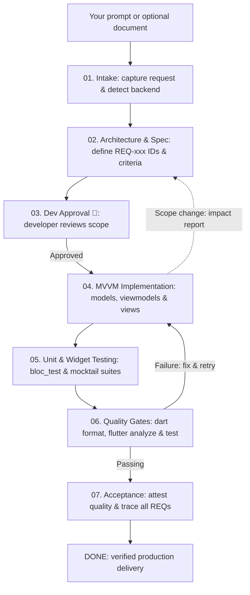

# FlutterCrew

[](https://flutter.dev)
[](https://dart.dev)
[](https://www.npmjs.com/package/flutter-crew)
[](LICENSE)

**Turn requirements into production-ready Flutter apps with Firebase or Supabase.**

## Quick install

**Requires:** Node.js 18+, Flutter/Dart SDK and a tool-capable AI assistant in your IDE.

### New Flutter project

```bash
npx flutter-crew init
```

Choose your platforms, backend and state management. FlutterCrew creates the
Flutter project, adds dependencies and installs the agent configuration.

### Existing Flutter project

Run inside your Flutter project:

```bash
npx flutter-crew
```

Changed configuration files are backed up before replacement; settings are not merged.

**Using this checkout before its npm release?** From the FlutterCrew repository,
install the local version into your Flutter project:

```bash
node bin/cli.js /path/to/flutter_project
```

### Uninstall from a project

Run inside your Flutter project:

```bash
npx flutter-crew uninstall
```

Or from the FlutterCrew checkout:

```bash
./uninstall.sh /path/to/flutter_project
```

This cleans `.agents/`, `.fluttercrew/`, prompts, and restores original files from installer backups.

## Build your first feature

### 1. Open your assistant

**VS Code Copilot:** open the Flutter project, select **FlutterCrew** in the agent
picker and describe what you want. `/fluttercrew-deliver` is an optional shortcut.

**Google Antigravity:** open the Flutter project and use its tool-capable agent.
If workspace instructions are not discovered, ask it to read `AGENTS.md` and follow
the FlutterCrew delivery workflow for your request.

### 2. Describe your app—in your own words

For example, in either IDE:

```text
Create a Flutter task manager using Firebase Auth and Firestore.
Users can sign in, manage their own tasks and sync across devices.
Use Riverpod and a clean, responsive UI.
```

**No special wording or requirements file is needed.** The agent saves your request
internally, separates assumptions and asks only blocking questions. For a larger
project, optionally attach/reference your own requirements document—any filename.
If Copilot's custom agent is unavailable, use the same instruction-loading fallback
as Antigravity. Agent discovery/delegation depends on IDE version and policy.

### 3. Review progress on the Live Web Dashboard

FlutterCrew provides a real-time developer dashboard to monitor progress across the entire delivery lifecycle:


Open the dashboard anytime from your terminal:

```bash
# Open the live visual web dashboard in your default browser
node .agents/runtime/crew.js dashboard --open

# Check quick terminal status
node .agents/runtime/crew.js status
```

The dashboard auto-refreshes while the local watcher is running, including after
`done`, so subsequent source/evidence changes cannot leave a completed run looking
current. The watcher stops when the run is archived/removed or after 12 hours;
run `dashboard` again to restart it. Headless environments can run
`node .agents/runtime/crew.js watch` explicitly.
`status`, `dashboard`, the watcher and `finish` use the same live integrity checks.
The dashboard shows recorded stage counts, not an estimated delivery percentage.
The overview puts one primary issue, the next responsible role and one action
first. Other required actions are grouped in a collapsed affected-work section;
none of the completion gates are waived. The command button copies text only,
never executes a runtime command, and offers a selectable fallback if clipboard
access is unavailable.

Reading order is header, Next Action, Requirements & Work, Pipeline Lifecycle,
Verification & Evidence, Recent Activity, then Run Context & Technical Details.
On desktop, requirements occupy the main column; the pipeline and verification
share a sidebar in that order. On smaller screens these sections stack in the
same reading order. Next Action includes a linked current-stage summary so users
can see workflow focus without scrolling past all seven stages. Blockers stay in
Next Action regardless of their section of origin. Activity and context remain
collapsed by default at the bottom.

All seven stages remain visible, never replaced by a dropdown. The desktop
sidebar uses a vertical flow; screens up to 640px use a compact two-column snake
(rows: 1–2, 4–3, 5–6, then 7 beneath 6; arrows follow stages 1 through 7).
The DOM and keyboard order remain 1–7. A persistent CURRENT
marker identifies the workflow focus independently of the stage being inspected.
Only an explicit in-progress task adds the "In progress (recorded)" stage label;
inferred focus alone remains "Needs attention", and completed stages say "Complete".
Connector drawing and a short node highlight indicate entry/state changes; they
do not claim live execution. The dashboard uses a local monospace font stack,
terminal-inspired dark surfaces and syntax-like semantic colors, without external
font requests. Stage counts live beside the flow; requirement, check and review
counts live in their own sections instead of four independent metric cards.
Implementation/testing declarations, acceptance criteria and evidence belong to
each requirement. Completion records and their timestamps remain visible even
when current evidence is stale. An active step means "needs attention", not proof
that an agent or process is running.

Current completion is green, attention blue, stale evidence amber, blockers red
and pending/empty states neutral. Labels and icons carry meaning as well as color;
completed stages retain neutral backgrounds. Technical context and recent recorded
activity are available on demand, not presented as a live execution log.
Micro animations highlight actual state changes, with subtle entry, disclosure
and button feedback, without continuous activity pulses. Unchanged refreshes do not replay entry animations, and
`prefers-reduced-motion` disables motion. Within a tab, refresh preserves search,
filters, disclosure state, scroll position and the auto-refresh preference when
session storage is available; auto-refresh pauses while editing a text field.

---

## 7-Phase Delivery Pipeline

FlutterCrew follows an **SDD-led, Implementation-first, and Test-verified** lifecycle
through 7 explicit phases. Invalidated evidence can move a phase back to unfinished:

```text
[1. Intake] ➔ [2. Spec] ➔ [3. Dev Approval 👤] ➔ [4. Implementation] ➔ [5. Unit Testing] ➔ [6. Quality Gates] ➔ [7. Done]
```

| Phase | Specialist Role | Actions & Guarantees |
|---|---|---|
| **01. Intake & Brief** | `planner` | Ingests natural-language prompts or documents into `docs/fluttercrew/request.md`. Detects backend dependencies (`firebase`, `supabase`, or `none`). No active run is overwritten without reviewed changes. |
| **02. Architecture & Spec** | `architect` | Deconstructs user stories into stable `REQ-xxx` IDs with clear, testable Acceptance Criteria and MVVM data contracts in `docs/fluttercrew/spec.json`. |
| **03. Dev Approval 👤** | `developer` | Present `REQ-xxx` scope and criteria for review, then record `crew.js approve`. Approval is bound to the spec revision and spec/brief hashes. Runtime rejects `verify`/`finish` without current approval; it cannot prevent source edits or authenticate who approved. |
| **04. MVVM Implementation** | `flutter-reviewer` | Implements feature code using strict separation of concerns: Models & Repositories ➔ ViewModels (Cubit/BLoC/Riverpod) ➔ Pure Views. Prevents business logic leaks in UI widgets. |
| **05. Unit & Widget Testing** | `tdd-guide` | Authors unit tests for ViewModels/Services and widget tests for critical user flows (`bloc_test`, `mocktail`). Enforces >= 80% coverage on business logic. |
| **06. Quality Gates** | `crew.js runtime` | Executes strict local verifications: `dart format`, `flutter analyze --fatal-infos`, and `flutter test`. Captures log artifacts in `.fluttercrew/logs/`. |
| **07. Acceptance & Done** | `fleet lead` | Validates hash-anchored trace reports (`docs/fluttercrew/traces/REQ-xxx.json`) and attests 5 quality dimensions (`requirements`, `design`, `backend`, `security`, `experience`) before completing `finish`. |

### Traceability & Verification Guarantees

- **No Silent Omissions**: Every `REQ-xxx` ID must be linked to verified implementation files, test files, and executed evidence.
- **Recorded Work, Not File Heuristics**: Explicit per-REQ tasks and current passed traces drive implementation stages. New test files and modification times are activity hints only, never proof that implementation is complete.
- **Approval Integrity**: `approve` rejects a changed/unbaselined spec or brief. Rebaselining requires approval again, even if performed within the same second. Legacy timestamp-only approvals are stale and must be re-recorded after developer review.
- **Source/Evidence Freshness**: Source edits invalidate prior verification, traces, completed tasks and review attestations. Changed execution logs invalidate verification; changed review evidence invalidates that review. This detects changes at runtime checks, not at file-write time.
- **Zero Hallucination Backend**: Real Firebase or Supabase configurations are verified via preflight checks. Missing backend credentials block delivery gracefully (`BLOCKED`) instead of fabricating fake passes.

## How the agents work

You describe the outcome; the **FlutterCrew lead** coordinates the relevant specialists and keeps track of unfinished work.



- **No need to call each agent yourself.** Use the delivery lead for the full workflow; focused shortcuts below handle individual tasks.
- **Only relevant roles run.** Copilot delegates when supported; Antigravity or other hosts can perform the same role passes sequentially without native subagents.
- **Green tests alone are not enough.** Missing/stale requirements or review findings must be resolved; backend access and deployments still need your approval.

## Resume or check progress

In a new chat, ask the agent:

```text
Read AGENTS.md and resume the current FlutterCrew run.
Check status, continue unfinished requirements, and revalidate stale evidence.
```

You can also inspect progress directly from the Flutter project:

```bash
# Check status report
node .agents/runtime/crew.js status

# Resume without resetting the brief, tasks or valid evidence
node .agents/runtime/crew.js resume

# Open the live visual web dashboard
node .agents/runtime/crew.js dashboard --open
```

Both `status` and `resume` return `nextAction` and ordered `nextActions`, each with
an `issue`, `cause` and next `commands`. `resume.retained` lists current approval,
verification, requirement traces, reviews and completed tasks;
`resume.remaining` lists work needing attention. Resume only inspects and renders:
it does not execute gates, rewrite the manifest, replan or claim stale evidence is
reusable. Source changes conservatively invalidate all source-bound evidence;
changing one review report alone does not force valid automated gates to rerun.

Record work explicitly as it happens:

```bash
node .agents/runtime/crew.js task REQ-001 implementation in_progress "Implementing auth transitions"
node .agents/runtime/crew.js task REQ-001 implementation done "Auth transitions implemented"
node .agents/runtime/crew.js task REQ-001 testing blocked "Waiting for emulator access"
node .agents/runtime/crew.js task REQ-001 testing done "Tests executed; results linked in trace"
```

Task phases are `implementation|testing`; states are
`pending|in_progress|done|blocked`, with non-empty notes required. Completed tasks
are bound to current inputs and become stale after edits; all tasks become stale
on spec revision. Reconcile and re-record stale tasks rather than blindly marking
them done. Tasks for removed requirements no longer belong to the current scope.
Declared unfinished/stale tasks block `finish`. Tasks remain optional for existing
runs with complete traces, and never replace trace, verification or review evidence.
Neither a passing `verify` alone nor a newly created test file completes implementation.

## Copilot shortcuts: when and how to use them

Shortcuts are saved prompts for **Copilot Chat**, not Terminal commands. They are
optional: describing the same task in normal language also works.

1. Open your Flutter project in VS Code and open **Copilot Chat**. Choose the
  **FlutterCrew** agent for full delivery, or a tool-capable agent for a focused task.
2. Type `/`, select a shortcut from the suggestions, then add your task after it.
3. Attach relevant files with **Add Context** or drag them into chat. For build
  failures, include the actual error output. Send the message.

**Not sure which to pick?** Use `/fluttercrew-deliver` to implement a feature or
app end to end. Use the others for a specific job on an existing project; you do
**not** need to run them all in order or run `/plan` before delivery.

| When you need… | Example to enter in Copilot Chat | Expected result |
|---|---|---|
| A complete feature/app | `/fluttercrew-deliver Build a task manager using Firebase and Riverpod.` | Spec, implementation, tests and review; `DONE` or an explicit blocker |
| A plan before committing to implementation | `/plan Plan email login with Firebase. Do not implement yet.` | Scope, architecture, backend contracts and test strategy—not a built feature |
| Feedback before merging code | `/flutter-review Review the attached file for rebuilds, lifecycle bugs and accessibility.` | Prioritized findings and suggested fixes; review alone does not apply them |
| Tests for existing behavior | `/flutter-test Add and run tests for the attached Cubit, covering success, failure and retry.` | Test files and execution results, or a tool/environment blocker |
| A failing analyzer/build/dependency resolution | `/build-fix Fix the flutter analyze errors pasted below.` | Targeted code/config fixes; include the error output and ask for a rerun to verify |
| Firebase integration work | `/firebase-setup Add email sign-in and owner-only profile access.` | Firebase client integration and relevant rules; project access/config may be needed |
| Supabase integration work | `/supabase-setup Add private notes with per-user RLS and Flutter data access.` | SQL migrations/policies and client integration; project access/config may be needed |

Backend shortcuts do not automatically create or deploy cloud resources. Choose
the one matching your backend; no need to run both.

If a shortcut is missing, check that FlutterCrew is installed in the open project
and your Copilot version supports prompt files. You can still describe the task
directly. In Antigravity, use natural-language requests with the shared workflow;
these Copilot shortcut names are not assumed to be registered there.

## Go deeper

- [Delivery workflow](.agents/workflows/feature-delivery.md)
- [Spec-driven development and change control](.agents/workflows/spec-driven-delivery.md)
- [Spec template](.agents/templates/spec.example.json) · [Trace template](.agents/templates/trace.example.json)

## License

[MIT](LICENSE)